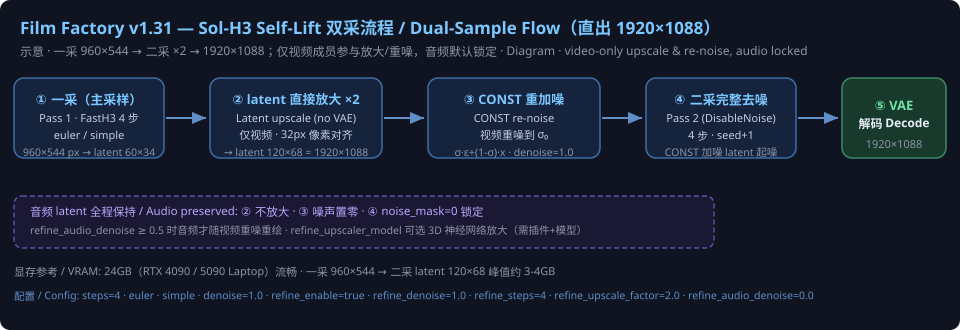

# BSAI ComfyUI H3 Film Factory ｜ BSAI ComfyUI H3 Film Factory

**MiniMax H3 电影工厂** — 多 Clip 分镜逐帧生成 + 单 Clip 重渲染 + 参考图资产库 + 二次采样画质修复 + per-Clip 实时预览解码
**A complete film production toolkit for MiniMax H3** — multi-Clip storyboard generation, single-Clip re-render, asset library, dual-sample quality refinement, per-Clip live preview

> 中文说明见下方；English documentation follows each section.

---

| 📖 介绍 | 🚀 渲染管道速查 | 🧩 节点 | ⚙️ 参数 | 🎬 透明视频 | 📝 更新说明 | 📦 安装 | 🎬 示例 |
|---|---|---|---|---|---|---|---|
| [插件介绍](#插件介绍--introduction) | [渲染管道速查与画质/速度最佳设置](#渲染管道速查与画质速度最佳设置--render-pipeline-guide) | [节点清单](#节点清单--node-list) | [主节点参数](#主节点参数--main-node-parameters) | [透明视频管道](#透明视频渲染管道--transparent-video-pipeline-v14233) | **[👉 全部更新说明](./CHANGELOG.md)** | [安装](#安装--installation) | [工作流示例](#示例工作流--example-workflows) |


## 渲染管道速查与画质/速度最佳设置 / Render Pipeline Guide

> 本节为 v14.311 新增，帮助你在 30 个渲染管道档位中快速选到**最佳画质**或**最佳速度**的搭配。
> This section (added v14.311) helps you pick the best-quality or best-speed recipe among the 30 render-pipeline tiers.

### 一、先选模式：分镜剪辑 vs 一镜到底 / Pick the mode first

| 模式 | 何时用 | one_shot_mode | 段间拼接 |
|---|---|---|---|
| **分镜剪辑（默认）** | 多镜头 MV、广告、有明确切镜 | `off (storyboard)` | xfade 转场 |
| **一镜到底** | 30s+ 连续跟拍、长镜头 | `on (one-shot)` | 无缝 concat（零转场） |

**一镜到底时再选采样档 one_shot_sampling：**

| 采样档 | 接缝漂移 | 什么时候选 |
|---|---|---|
| **Single-pass seamless（推荐）** | 零漂移 | 快速出片、6~8步 turbo LoRA 链 |
| **Dual-pass seamless (8+4)** | 已修复 | 需要二采 refine 但不要接缝漂移 |
| **Dual-pass seamless 2K (8+4)** | 已修复 | 一镜到底直出 2K 成片 |
| Dual-pass HD (seam risk) | 有漂移 | 不推荐，仅老工作流兼容 |

### 二、最佳画质配置 / Best-Quality Settings

> 目标：细节最锐、色彩最准、动作最稳，单段耗时较长但一次出片不返工。

| 项 | 推荐值 | 原因 |
|---|---|---|
| **render_pipeline** | `Sol-H3 Self-Lift Dual-Pass (default)` | 默认双采 refine，SelfLift TST 校闪屏/身份漂移 |
| **speed_preset** | `Fine`（8+6，denoise 0.5） | 步数最多，细节最足 |
| **one_shot_mode** | off（或 on + Dual-pass seamless 2K） | 一镜到底时选 2K 档 |
| **refine_mem_mode** | `global (full-context, low VRAM)` | 全序列注意力无 tile 接缝 |
| **selflift_tst_enable** | **on**（tau 0.2） | 少步补偿，防闪/防漂移 |
| **dual_track_shift** | on（shift_video=12, shift_audio=3） | 官方双轨迹，A/V 同步最好 |
| **face_lock_mode** | `auto (face-lock)` | 锁五官一致 |
| **block_cache / cache_dit** | **off** | 追求画质时关闭缓存 |
| **LoRA** | 不挂加速 LoRA（用原生 20~24 步）；或 `MysticXXX_MMH3-V4`(0.3~0.5) 去油光 | 加速 LoRA 会损失细节 |
| **分辨率** | 1920×1088（默认双采）或 2K 档 | |

**画质天花板**：`4K Direct Secret Sauce`（4K直出）或 `4K Regenerate OpenH3Regenerate2K`（768P→2560 重生成），适合最终交付的电影感成片。

### 三、最佳速度配置 / Best-Speed Settings

> 目标：单段最快出片，用于分镜预览、草稿、迭代。最终交付前再切画质档。

| 项 | 推荐值 | 单段耗时 | 原因 |
|---|---|---|---|
| **render_pipeline** | `PDMD 2-step Turbo Draft` | ~3 min | 2 NFE 极速单采，**仅草稿** |
| 或 | `TaoMate HD 3-Step Progressive` (2+1) | ~5 min | 3 NFE 直出 1080p，速度/质量平衡最佳 |
| 或 | `PIKA H3 Flex 6+2` | ~8 min | 6步直出 1080p，Ref2VA 锁脸 |
| 或 | `PDMD 4-step SelfLift Dual-Pass` (4+2) | ~10 min | 6 NFE，少步高质量 |
| **speed_preset** | `Turbo`（4+3） | ~20 min | 不换管道时的快速档 |
| **one_shot_sampling** | `Single-pass seamless` | — | 跳过二采，链 latent 不被重绘 |
| **selflift_tst_enable** | on（tau 0.2） | +1~2% | 少步必开，否则闪屏/漂移 |
| **分辨率** | 960×544 latent（VAE 原生解码 1920×1088） | — | PIKA/TaoMate 都走这条 |

**速度 LoRA 必挂**（按管道选）：
- `minimax_h3_pdmd_2step_lora_avg_rank_38_bf16`（2步草稿）
- `minimax_h3_pdmd_4step_lora_avg_rank_57_bf16`（4步双采）
- `TaoMate-HD-preview-comfy.safetensors`（3步渐进，strength 1.0）
- `pika_h3_flex_ref2va_v1_bf16`（6步，strength 1.0，**禁叠第二个加速 LoRA**）

### 四、33 个渲染管道速查 / All 33 Pipelines at a Glance

| # | 管道 | NFE | 推荐 LoRA / 基模 | 定位 |
|---|---|---|---|---|
| 1 | Sol-H3 Self-Lift Dual-Pass（默认） | 自定义 | 无强制；SelfLift TST on | **画质默认** |
| 2 | MV Dual-Pass（电影工厂原版） | 自定义 | 无 | 老工作流 |
| 3 | Live Dub HD | 12+4 | ref2va_int8_convrot | 配音 |
| 4 | FastH3-Trim | 8+4 | nvfp4 剪枝 | 省显存 |
| 5 | FastH3 4-step VSA | 4+2 | 4步蒸馏+VSA | 快速预览 |
| 6 | Turbo-v4 | 6+4 | turbo_v4_step600(0.5~0.8)+MysticXXX_V4(0.3~0.5) | 日常加速 |
| 7 | DMAD 4-step | 4+2 | DMAD 4步 LoRA（强制 lcm） | 动作 |
| 8 | Action Combo | 8+4 | action/DMAD via H3LoraStack | 动作片 |
| 9 | **4K Direct Secret Sauce** | 6+3 | turbo_v4+MysticXXX_V4+DLSS5 | **4K画质** |
| 10 | FastH3 Omni 8-step Single-Pass | 8单采 | fasth3_omniref_8step_pruned_int8 + VSA keep=10 | 极速单采 |
| 11 | Dual-Pass 2K (HyperVAE) | 8+4 | VAE: hyper*2x*.safetensors | 2K快速 |
| 12 | QAD-v2 8-step | 8单采 | QAD-v2 NVFP4 全套（118→30GB） | 量化省显存 |
| 13 | Live Commerce 01 Text Dubbing | 12+4 | 无 | 纯文本配音 |
| 14 | Live Commerce 02 ref_audio | 12+4 | 无 | 音色参考 |
| 15 | Live Commerce 03 lip_voice | 12+4 | 无 | TTS对口型 |
| 16 | Live Commerce（全自动） | 12+4 | 无（一键档） | 直播带货 |
| 17 | FastH3 Omni x SelfLift Upscale | 8 | Omni 8步 + SelfLift 渐进 | 蒸馏+放大 |
| 18 | H25 Hybrid 8-step Multi-Ref | 8单采 | fl2v_turbo_8step(1.0)；FL2VA+Ref2VA b25-49 | 多参考图 |
| 19 | **4K Regenerate OpenH3Regenerate2K** | 3 | OpenH3 Refiner(0.7)+fl2v turbo(1.0)+lms sharp(1.0) | **4K画质**（不含EU/UK/KR/US） |
| 20 | PRISM 10-step Motion | 10单采 | Singularity v2 x 10Eros-Max 合并模型 | 运动表现 |
| 21 | Transparent Video Single-Pass | 10单采 | 纯色背景 + BSAI_H3_TransparentKey | 抠像/透明 |
| 22 | 4-in-1 Ultimate Speedup | 6+2 | DMAD 4步+SegAttention 2.2.0+半分辨率参考 | 极限加速 |
| 23 | SolarRenderer Structure Control | 4+4 | 控制LoRA+4步LoRA(0.8)；FastH3-Omni/Singularity V2 | 结构控制 |
| 24 | Director Turbo Dual-Pass | 8+4 | Director 控制视频代替 ref2va | 导演分镜 |
| 25 | Dual-Pass 2K (official condition upscale) | 8+4 | 官方 MiniMaxH3LatentUpscaleCombined | 官方2K |
| 26 | **PDMD 4-step SelfLift Dual-Pass** | 4+2 | pdmd_4step_lora_avg_rank_57_bf16 | **少步高质量** |
| 27 | **PDMD 2-step Turbo Draft** | 2单采 | pdmd_2step_lora_avg_rank_38_bf16 | **极速草稿** |
| 28 | PTD 4-step Ref2VA | 4单采 | per-hop Ref2VA 加速 LoRA | 参考图加速 |
| 29 | **PIKA H3 Flex 6+2** | 6单采 | pika_h3_flex_ref2va_v1(1.0，禁叠加速LoRA) | **直出1080p** |
| 30 | **TaoMate HD 3-Step Progressive** | 2+1 | TaoMate-HD-preview-comfy(1.0，禁叠加速LoRA) | **1080p性价比王** |
| 31 | **TaoMate HD 8+4 Progressive** | 8+4 | TaoMate-HD-preview-comfy(1.0，禁叠加速LoRA) | **1080p画质版** |
| 32 | Singularity V2 + Pika H3 8步 高动态 | 8+3 | Singularity v2 基模 + pika_h3_flex_turbo_8step_hd | 高动态长视频 |
| 33 | **视频替换 (V2V 人物替换)** | 8单采 | 源视频@视频N + 人物参考图@图N；建议 角色替换 LoRA(0.6~0.8) | **人物替换** |

### 五、全局开关默认值（出片前核对）/ Global Switches

| 参数 | 最佳画质 | 最佳速度 |
|---|---|---|
| `dual_track_shift` | on（12/3） | on（12/3） |
| `selflift_tst_enable` / tau | on / 0.2 | on / 0.2 |
| `temporal_chunk_tokens` | 0（关） | 0（关） |
| `refine_mem_mode` | global（无接缝） | spatial（4块，快） |
| `face_lock_mode` | auto | auto |
| `block_cache` / `cache_dit` | off（画质） | on（速度） |
| `semantic_bridge_enable` | 按需（增强指令遵循） | off |

### 六、按场景一键选 / Pick by Scenario

| 场景 | render_pipeline | one_shot | LoRA |
|---|---|---|---|
| 电影感最终交付 | 4K Direct Secret Sauce / OpenH3Regenerate2K | off | turbo_v4+MysticXXX_V4 |
| 日常一镜到底 MV | Sol-H3 Self-Lift Dual-Pass | on + Dual-pass seamless 2K | 无 |
| 一镜到底快速预览 | PDMD 4-step / PIKA H3 Flex | on + Single-pass seamless | 对应加速 LoRA |
| 直出 1080p 性价比 | TaoMate HD 3-Step (2+1) | on/off 均可 | TaoMate-HD-preview-comfy |
| 分镜草稿迭代 | PDMD 2-step Turbo Draft | off | pdmd_2step_lora |
| 直播带货成片 | Live Commerce (fully automatic) | off | 无（12+4 一键） |
| 结构控制短片 | SolarRenderer Structure Control | off | 控制LoRA+4步LoRA |
| 抠像/透明素材 | Transparent Video Single-Pass | off | 无 |
| **视频人物替换（换人）** | **视频替换 (V2V 人物替换)** | off | 角色替换 LoRA(0.6~0.8) 可选 |

### 七、视频人物替换（V2V Recast）/ Video Character Replacement (v14.335)

**用途**：把一段视频里的**人**换掉 —— 机位、运镜、剪辑点、走位、口型、原声全部保留，只替换人物身份；支持单人、多人，可跨多个 clip 连续替换。

**四步用法 / Use it in four steps**：
1. `BSAI_AssetLibraryInput` 上传**被替换的源视频**到资产库视频位，记作 `@视频N`（`@vidN` 同义）；
2. 同一资产库上传**替换成的人物参考图**到图片位，记作 `@图1` / `@图2`…（一人一张，多人多张）；
3. 渲染管道下拉选 **「视频替换 (V2V 人物替换)」**（英文规范值 `Video Recast (H3 V2V character swap)`）；快捷条上点 **「Video Recast」** 按钮同样一键到位；
4. 分镜卡片写替换指令：`@图1 替换 @视频1 里的主持人，其余人不变`；要跨段继续换就下一张卡片接着写 `@图2 替换 @视频1 里的女嘉宾`。

**45s 源视频的例子 / 45-second example**：分镜里写一次 `@视频N` 即可。后端探测源视频 45s → `ceil(45/15)=3` 段，每段 ≈15s（帧数对齐 H3 的 17k+5 网格）；分镜只有 1 张就自动补成 3 张（自动补的卡片 `id` 带 `_recast_k` 后缀），逐段替换后按顺序拼接成片。分镜多于所需时，多出来的段没有源画面可换，会被跳过并打印说明。

**后端强制参数（手改 widget 无效，除 denoise）**：一采 8 步 `euler`+`simple`、shift 12/3、denoise 0.72（v14.337 起）、二采关闭、段间 motion context 全关、源原声锁定（音频 `noise_mask=0`）。`denoise` 是唯一开放的旋钮：调高（→0.9）= 更听参考图、换得更彻底，但动作/构图更易偏离原片；调低（→0.35）= 更贴原片、换得不够彻底。

**场景锁定（v14.337 / region-locked redraw）**：视频 `noise_mask` 不再是全 1。后端逐帧调本机 NPU 服务（`POST /detect_pose` + `POST /segment_foreground`，YOLO 人体框 + GrabCut + RMBG-1.4），把「人物区域」做成掩码：**人区 = 1（允许重绘），其余 = 0（直接锁定源像素）**，再按 H3 的 17 帧步长采样到 latent 网格。于是背景、街景、道具、光源是源片本身的像素，模型没有机会把夜景换成室内；人物区连同衣服一起放开重绘，配合提示词纪律块（"原视频服装与配饰一律不得保留"）拿到参考图那套服装。日志会打印 `人物掩码已生成：N/M 帧分割成功，人区占画面 xx%` 与每段 `重绘区=人物掩码 xx%`。掩码失败（NPU 服务掉线）时退回全画幅重绘并告警 —— 此时场景会漂，先查 `GET /health`。

> 环境变量微调：`BSAI_H3_RECAST_SUBJECT_MASK=0` 关掉掩码；`BSAI_H3_RECAST_MASK_DILATE`（默认 13 像素，人区外扩）、`BSAI_H3_RECAST_MASK_FEATHER`（默认 10，边缘羽化）、`BSAI_H3_RECAST_MASK_PORT`（默认取 ComfyUI 端口）。


**注意 / Notes**：
- 源视频按**当前画布分辨率**等比放大 + 居中裁切后再编码，源片比例与画布不一致时会被裁边；
- 源视频没有音轨（或没接 `audio_vae`）时，音频行改由模型重新生成，日志会告警 —— 此时口型不再跟随源片；
- 替换档会忽略 `lip_audio` 对口型输入（v14.336 起在分镜重排之前就剔除），日志提示一次 —— 本档口型由源原声逐帧锁定，另接 `lip_audio` 只会把单段拉成 200s 级长段并爆显存；
- v14.336 起：分镜提示词里**没有 `@视频N`**（或资产库 Videos 位没有源视频）时，本档**直接报错中止**，不再静默退回普通渲染；
- 依赖 ffmpeg（整合包自带 / `imageio-ffmpeg` 提供），时长探测走 ffprobe 优先、`ffmpeg -i` 兜底。

> **完整 LoRA 文件名与强度**见 [`RENDER_PIPELINES_REFERENCE.md`](./RENDER_PIPELINES_REFERENCE.md)。
> Full LoRA filenames & strengths: see [RENDER_PIPELINES_REFERENCE.md](./RENDER_PIPELINES_REFERENCE.md).

---


**H3 Film Factory** 是 BSAI 出品的 MiniMax H3 一站式电影制作节点集。它把"剧本分镜 → 逐镜头生成 → 画质修复 → 字幕 → 拼接成片"的完整影视流程整合进 ComfyUI：

**H3 Film Factory** is BSAI's all-in-one film production toolkit for MiniMax H3 in ComfyUI. It covers the whole movie pipeline: **storyboard → per-shot generation → quality refinement → subtitles → final assembly**.

### 核心能力 / Core capabilities
- **多 Clip 分镜逐帧生成**：`BSAIH3FilmFactory` 一个节点管理整部片子的分镜（CLIP 卡片），每张卡片独立提示词/字幕/音效/资产引用，逐 clip 生成、可预览可暂停。/ Multi-Clip storyboard: each CLIP card has its own prompt / subtitle / audio / asset refs, rendered clip-by-clip with preview & pause.
- **单 Clip 重渲染**：只重出某一个镜头（改提示词/换资产后重出该段），其余镜头不动。/ Re-render a single Clip only.
- **参考图资产库**：`BSAI_AssetLibraryInput` 上传图片/视频/音频，提示词用 `@图N` / `@视频N` / `@音频N` 引用。/ Asset library with `@图N` / `@视频N` / `@音频N` notation.
- **Sol-H3 Self-Lift 双采（v1.31）**：主采样后 latent 直接放大（不经过 VAE）+ CONST 重加噪 + 二采完整去噪，一采+二采直出 1920×1088 高清视频；音频默认锁定不重绘。/ Sol-H3 Self-Lift dual-sampling (v1.31): latent upscale (no VAE) + CONST re-noise + full second pass, direct 1920×1088 output; audio locked by default.
- **per-Clip 实时预览**：每生成完一个 clip 立即解码预览（图像+音频），可暂停/继续/仅保留当前/合并输出。/ Live preview after each clip with pause / continue / stop / merge controls.
- **字幕系统**：`BSAI_SubtitleConfig` + `BSAI_SubtitleRenderer` 支持旁白/对白字幕渲染。/ Subtitle config + renderer (narration / dialogue).
- **上下文帧提取/加载**：从长视频提取上下文帧建立运动连贯链（RAM/磁盘两种方案）。/ Contextual frame extraction & loading for motion continuity (RAM & disk backends).
- **3D Latent Upscaler**：`BSAI_H3_3DLatentUpscale` 神经网络语义放大 latent，比插值保留更多细节。/ Neural 3D latent upscaling.
- **透明视频管道（v14.233）**：`render_pipeline` 第20档「透明视频 单采抠像」+ `BSAI_H3_TransparentKey` 抠像台 + `BSAI_H3_SaveTransparentVideo` 导出：纯色背景（绿幕/蓝幕/纯黑）生成 → 一键抠像（Matte 预设 + 边缘去溢色）→ 输出带真 Alpha 的 ProRes 4444 / WebM VP9 / RGBA PNG 序列（B站 BV1arJX69E7L 配方）。/ Transparent video pipeline (v14.233): tier-20 single-pass + keying studio + alpha export (ProRes 4444 / WebM VP9 / RGBA PNG) per Bilibili BV1arJX69E7L.

---

## 节点清单 / Node List

全部位于 `BSAI/H3 Film Factory` 相关分类 / All under BSAI/H3 Film Factory categories:

| 节点 / Node | 作用 / Role |
|---|---|
| **BSAIH3FilmFactory**（核心主节点）| 多 Clip 分镜生成主节点：run_mode/分辨率/采样/上下文/缓存/二次采样/CLIP选择/暂停 全套控制。/ Main multi-Clip generation node with full control set. |
| **BSAIH3FilmFactoryFinalDecode** | 最终解码输出节点（codec/输出路径设置），= MiniMaxH3MotionContextDiskFinalDecode。/ Final decode & export with codec settings. |
| **MiniMaxH3MotionContextRAM** | 内存版运动上下文链（首尾帧衔接，长片连贯）。/ In-RAM motion context chaining. |
| **MiniMaxH3MotionContextDiskJoin** | 磁盘版运动上下文连接。/ Disk-based motion context join. |
| **MiniMaxH3TailFromLatent** | 从 latent 提取尾帧/音频（衔接下一 clip 用）。/ Tail frame/audio extraction from latent. |
| **MiniMaxH3PromptPackBridge** | 动态提示词打包桥（多输入提示词组合）。/ Dynamic prompt input packer. |
| **BSAI_ContextualSeriesExtract** | 上下文帧提取（last_n/first_n/middle_n/custom_range）。/ Contextual frame extraction. |
| **BSAI_ContextualSeriesLoad** | 上下文帧加载（even/sequential/all）。/ Contextual frame loading. |
| **BSAI_AssetLibraryInput** | 资产库：上传图片/视频/音频，索引为 图1,图2…/视频1…/音频1…。/ Asset library uploader with indexing. |
| **BSAI_AssetRefSelector** | 资产引用选择器：按提示词中 `@图N`/`@视频N`/`@音频N` 自动选资产。/ Selects assets referenced by @notation. |
| **BSAI_ImageBatchSplitter** | IMAGE 批次拆分（H3 多参考图输入用）。/ Split image batch for H3 ref inputs. |
| **BSAI_ClipComposer** | 片段编辑器：单 clip 提示词/字幕/音效/资产引用。/ Define a single clip. |
| **BSAI_ClipSequencer** | 分镜编排器：自带纵向 CLIP 卡片故事板。/ Self-contained storyboard sequencer. |
| **BSAI_SubtitleConfig** | 字幕配置（样式/字体/位置）。/ Subtitle styling config. |
| **BSAI_SubtitleRenderer** | 字幕渲染器（旁白/对白上屏）。/ Subtitle renderer. |
| **BSAI_VideoCombiner** | 视频拼接（最多 16 段）。/ Concatenate up to 16 video clips. |
| **BSAI_AudioCombiner** | 音频拼接（最多 16 轨）。/ Concatenate up to 16 audio streams. |
| **BSAI_H3_3DLatentUpscale** | 3D latent 神经网络语义放大（比插值更清晰）。/ Neural 3D latent upscale. |
| **BSAI_H3_TransparentKey** | 透明视频抠像台：绿幕/蓝幕/纯黑/纯白背景一键抠成 Alpha（Matte 预设 + 边缘柔化/choke + 去溢色），输出 straight-alpha RGBA + Matte + 棋盘格预览。/ Transparent keying studio (chroma/luma key + edge refine + de-spill). |
| **BSAI_H3_SaveTransparentVideo** | 透明视频导出：ProRes 4444（真 12bit Alpha）/ WebM VP9 / RGBA PNG 序列，可选音频合流，输出到 `output/H3_transparent_video/<子文件夹>/alpha/` + `preview/`。/ Transparent video writer with real alpha (ProRes 4444 / WebM VP9 / PNG). |

---

## 主节点参数 / Main Node Parameters

以下为 `BSAIH3FilmFactory`（及 `BSAIH3FilmFactoryFinalDecode`）核心参数中英对照。/ Bilingual reference for the main generation node.

### 基础参数 / Basic
| 参数 / Parameter | 中文说明 / Meaning | 选项 / Options | 默认 / Default | 使用说明 / Notes |
|---|---|---|---|---|
| `run_mode` | 运行模式 | `clip_by_clip` / `full_batch` | `clip_by_clip` | 逐 clip 生成（每 clip 可预览）/ 全批一次生成 |
| `width` | 宽度（手动分辨率）| 32 倍数，≤4096 | `896` | 手动模式渲染宽度 |
| `height` | 高度（手动分辨率）| 32 倍数，≤4096 | `576` | H3 原生最佳 896×576 |
| `ref_image_size` | 参考图尺寸策略 | `match` / `max` | `max` | 匹配参考图尺寸 / 取最大参考图尺寸 |
| `steps` | 采样步数 | 正整数 | `4` | FastH3 蒸馏推荐 4；原生推荐 20-24 |
| `sampler_name` | 采样器 | `euler` 等 | `euler` | **FastH3 必须 euler** |
| `scheduler` | 调度器 | `simple` 等 | `simple` | **FastH3 必须 simple** |
| `denoise` | 降噪强度 | 0.0-1.0 | `1.0` | 1.0=全量重绘；图生视频可降低保留参考结构 |

### 上下文参数 / Context
| 参数 | 中文说明 | 默认 | 说明 |
|---|---|---|---|
| `context_length` | 上下文长度（H3 时间上下文帧数）| `22` | 每 clip 的 latent 上下文帧数 |
| `audio_context_length` | 音频上下文长度 | `0` | 0=自动匹配 |

### 分辨率参数 / Resolution
| 参数 | 中文说明 | 默认 | 说明 |
|---|---|---|---|
| `resolution_mode` | 分辨率模式 | `auto_from_ref` | 自动（按参考图+MP）/ 手动 width/height |
| `megapixels` | 自动分辨率目标总像素 | `0.40` | 0.40≈896×448 |

### 输出参数 / Output
| 参数 | 中文说明 | 默认 | 说明 |
|---|---|---|---|
| `output_mode` | 输出模式 | `none` | none 仅缓存 / per_clip 分段 / merged 合并 / both |
| `filename_prefix` | 文件名前缀 | `H3_Extender` | 输出文件前缀 |
| `output_image_audio` | 每 CLIP 即时解码预览 | `true` | 关闭可加速但无预览 |

### 缓存加速 / Caching
| 参数 | 中文说明 | 默认 | 说明 |
|---|---|---|---|
| `block_cache` | 块缓存加速（F1B0 残差，需 T8 插件）| `false` | 追求最佳画质建议关闭 |
| `block_cache_threshold` | 块缓存阈值 | `0.12` | 越高越易命中、越省时 |
| `block_cache_device` | 缓存设备 | `cpu` | cpu 省显存 / gpu 更快 |
| `ref_cache` | 参考图 Ref2VA 编码缓存 | `true` | 调参重跑跳过重复编码，不影响画质 |
| `cache_dit` | DiT 步间缓存（需 CacheDiT 插件）| `false` | 追求最佳画质建议关闭 |

### CLIP 选择与暂停 / Clip Select & Pause
| 参数 | 中文说明 | 默认 | 说明 |
|---|---|---|---|
| `clip_select_enable` | CLIP 选择开关 | `false` | 启用后仅渲染指定 clip |
| `clip_select` | CLIP 选择 | `all` | `all` 全部 / `1,3` 多选 / `2-5` 范围 / `3,5,7` 混合多选 / `7-10` 范围；支持中文逗号 `3，5，7` |
| `pause_enable` | 每 clip 生成完暂停 | `false` | 等待用户操作 |
| `pause_timeout` | 暂停超时（秒）| `5` | 超时自动继续（默认 5s 最佳出片节奏） |

### Sol-H3 Self-Lift 双采（v1.31）/ Dual-sample Refine (v1.31)
> v14.138 起默认值已设为 5090 24G 实测最佳参数（8+2 双采）：开箱即用，新拉节点无需调整。
| 参数 | 中文说明 | 默认 | 说明 |
|---|---|---|---|
| `refine_enable` | 双采开关 | `true` | 默认开启：一采潜空间直接放大 + CONST 重加噪 + 二采完整去噪，直出高清 |
| `refine_denoise` | CONST 重加噪目标强度 | `0.45` | **默认 0.45=最佳质量与细节平衡（5090 24G 实测）**；1.0=全量重噪重绘；<0.5 有变脸风险 |
| `refine_steps` | 二采步数 | `2` | **默认 2（8+2 双采实测最佳）**；步数越多细节越丰富但时间越长 |
| `refine_upscale_factor` | 潜空间放大倍数 | `2.0` | 直出 1920×1088：一采 960×544 + 2.0x |
| `refine_upscaler_model` | 放大方式 | `(bilinear插值, 无需模型)` | 选 3D latent upscaler 模型=神经网络语义放大（需插件+模型，细节更丰富） |
| `refine_align_to` | 像素对齐步长 | `40` | **默认 40（H3 官方 40px 网格实测最佳）**；其他分辨率自动取整避免边缘色条 |
| `refine_audio_denoise` | 音频重绘强度 | `0.0` | 0=锁定一采音频（推荐）；0.5-1.0=音频随视频重绘 |

### 周报技术升级 P0-P2（v14.150）/ Weekly-Tech Upgrade P0-P2 (v14.150)
> 2026-10-17 落地《H3加速与画质提升技术周报》：官方双轨迹采样、Turbo v4 / DMAD 档位、SelfLift TST 少步数补偿。/ Landing the 2026-10-17 H3 weekly tech report: official dual-track sampling, Turbo v4 / DMAD presets, SelfLift TST few-step compensation.
| 参数 / Parameter | 中文说明 / Meaning | 默认 / Default | 说明 / Notes |
|---|---|---|---|
| `dual_track_shift` | P0 官方双轨迹采样 | `true` | MiniMaxH3SigmaShift 等效：video shift 驱动采样器 sigma 调度，audio schedule 由模型内部推导；改善音视频同步与少步数收敛。关=旧行为 |
| `shift_video` | Video flow shift | `12.0` | 官方默认 12；DMAD 配方 12；Turbo v4 12 |
| `shift_audio` | Audio flow shift | `3.0` | 官方默认 3；DMAD 配方 2 |
| `selflift_tst_enable` | P2 SelfLift H3 TST 补偿 | `true` | 时间状态传输（arXiv:2609.08505）校正闪烁/身份漂移/不合理运动，开销 1-2%；需已安装 `comfyui-SelfLift`（随本版已装） |
| `selflift_tst_tau` | TST 校正强度 | `0.2` | 论文推荐 0.2；0.5 过强；0=仅诊断 |
| `speed_preset`（新增档）| 加速预设 | `custom` | **`Turbo-v4`**=6+4 步、shift 12/3（Turbo LoRA v4 step600 EMA 舒适区，建议手动切 `res_multistep` 采样器贴合官方配方）；**`DMAD-4步`**=4+2 步、shift 12/2、采样器强制 `lcm`（DMAD 官方配方 LCM+simple，无 CFG≈1，需挂 DMAD LoRA）；**`QAD-v2-8步`**=8 步单采直出、shift 10/3（FastH3-QAD-v2 官方 V2 NVFP4 schedule，2026-10-20 海螺发布；推荐从「渲染管道」下拉选 QAD-v2-8步，本档仅供旧工作流兼容） |
| `render_pipeline`（v14.184+）| 渲染管道 | `Sol-H3 Self-Lift 双采 (默认)` | 双采默认档；**`FastH3 Omni 8步单采`**=8 步蒸馏直出、shift 12/3；**`双采2K`**=8+4 步直出 2K；**`QAD-v2-8步`**=8 步单采直出、shift 10/3（FastH3-QAD-v2 官方 schedule，需 Loader 换 QAD-v2 整套 NVFP4 模型 + BlockSparseAttention VSA keep_percent=10，VAE 可选 36层/8层 新 NVFP4 解码器）；**`H25 Hybrid 8步 多参考单采`**（v14.223+）=H25 Hybrid 混合架构（Base=FL2VA + Overlay=Ref2VA，Block Range Additive 25-49）+ LightX2V 8 步 FL2V 加速 LoRA，8 步单采直出、shift 12/3、跳过二采（B站 BV1dygg6EE6W 配方；需 Loader 换 `minimax_h3_hybrid_fl2va_ref2va_b25-49-int8.safetensors`，加速 LoRA 槽挂 `minimax_h3_fl2v_turbo_8step_v1.0_comfyui_bf16.safetensors` 强度 1.0；示例工作流 `example_workflows/BSAI_H3_Film_Factory电影工厂-H25Hybrid-8步多参考单采.json`）；**`4K重生成 OpenH3Regenerate2K`**（v14.229+）=768P 草稿直出 2560x1440 2K（NVLabs OpenH3Regenerate2K 开放模型，B站 BV13uxT66EWq 配方；需 Loader 挂合并 LoRA：OpenH3 Refiner 0.7 + fl2v turbo 1.0 + lms sharp 1.0，采样器 CFG=1.0；许可证排除欧盟/英国/韩国/美国）；**`PRISM 10步 运动强化单采`**（v14.231+）=Singularity v2 × 10Eros-Max 合并模型（PRISM，Ref2VA 系，int8 20.3GB），10 步单采直出、euler+simple、denoise 1.0、无 LoRA、跳过二采，提升运动流畅度与连贯性（B站 BV1Vino6qE2F 配方；需 Loader 换 `Minimax-h3_Singularity_x_10Eros-Max_PRISM_int8.safetensors`，建议 5 段式长提示词 + 参考图驱动） |

**配套 LoRA（已下载，loras/ 目录）** / Companion LoRAs (already downloaded):
- `minimax_h3_DMAD_4step_full_lora_avg_rank_39_bf16.safetensors`（Kijai 降秩版，DMAD-4步 档用）
- `minimax_h3_turbo_v4_step600_ema_DasiwaREF2VAHybridV1_0_curveproj1025_compat_v001.safetensors`（Turbo v4 step600 EMA，Turbo-v4 档用）


### 对口型×二采预设（v14.83）/ Lip-sync × Dual-sample Preset
| 参数 | 中文说明 | 默认 | 说明 |
|---|---|---|---|
| `refine_lipsync_mode` | 对口型×二采预设 | `锁定保口型(推荐)` | `锁定保口型(推荐)`=二采音频锁定一采音频不重绘(refine_audio_denoise=0)；`音频参与重绘0.7`=refine_audio_denoise=0.7；`音频全重绘1.0`=refine_audio_denoise=1.0。一采注入 lip_audio → 二采音频锁定保口型或参与重绘，开箱即用 |

### 像素超分旁支（v14.83-84）/ Pixel Upscale Branch
| 参数 | 中文说明 | 默认 | 说明 |
|---|---|---|---|
| `upscale_per_clip` | 逐段超分 | `false` | 每 CLIP 解码后逐段像素超分（单段显存可控；CLIP 卡片 H 按钮优先于此总开关）|
| `upscale_final` | 全片超分 | `false` | 全片合并后一次性像素超分（出片前统一处理，更快更省）|
| `upscale_mode` | 超分模式预设 | `平衡(质量+速度)` | 平衡=2.0x auto；质量优先=3.0x REALESR；速度优先=1.5x auto；自定义=按下方参数 |
| `upscale_engine` | 超分引擎 | `auto` | auto 自动选择 / dlss5（N卡）/ realesr（upscale_models）/ bicubic（内置，最快）|
| `upscale_factor` | 超分倍率 | `2.0` | 相对二采输出分辨率的像素放大倍率 |
| `upscale_model` | REALESR 模型 | `realesr-general-x4v3.pth` | `models/upscale_models/` 下的模型 |
| `upscale_tile` | 超分分块像素 | `0` | 0=整幅；显存不足设 512~1024 |
| `upscale_batch` | 超分批量帧数 | `4` | 显存换速度 |
| `upscale_fp16` | 超分 FP16 | `true` | 半精度加速 |
| `upscale_face_restore` | 超分人脸修复 | `false` | FaceRestore 预留（需权重+耗时）|

### 环境音与保脸（v14.83）/ Env Audio & Face Lock
| 参数 | 中文说明 | 默认 | 说明 |
|---|---|---|---|
| `env_audio_enable` | 模型环境音开关 | `global_inherit` | global_inherit 跟随全局 / on 混入 H3 自生成环境音 / off 只留主唱/克隆语音 |
| `env_audio_gain` | 环境音音量 | `0.15` | 0=无声，1=满音量 |
| `face_lock_mode` | 保脸/小脸修复模式 | `off (关闭)` | v14.221 三态枚举：`off (关闭)`=不额外处理 / `auto (常规保脸锁定)`=依靠 @img2.N 脸部特写参考注入 ref2v conditioning 维持五官一致（兼容旧布尔 true）/ `refine (小脸修复·H3局部重绘)`=出片前对每个分镜做 H3 FaceRefine 局部人脸重绘并缝合回去，专治远景小脸崩坏（需安装 BSAI-ComfyUI-FaceRefine 插件，开销较大）。旧工作流布尔 `false`→off，`true`→auto |

### CLIP 级超分开关（v14.85，前端按钮 v14.90 待恢复）
- 后端已支持每个 CLIP 的 `upscale` 三态字段（`跟随`/`强制超分`/`强制不超分`），**CLIP 级优先于总开关 `upscale_per_clip`**。
- 前端 CLIP 卡片内的三态按钮因 v14.86-88 快捷条事件已临时移除，稳定后恢复；在此之前可通过手动编辑 `clips_json` 中每个 clip 的 `"upscale": true/false` 生效。

### 一键化快捷开关条（v14.104-106）/ Quick Toggle Bar (v14.104-106)
- **位置**：CLIP 卡片区底部按钮栏（添加CLIP / 全部删除CLIP）后面，独立一行。/ Below the bottom button bar.
- **20 个一键开关（全部 true/false 布尔全覆盖）**：
  - **高频组（10）**：二采、逐段超分、全片超分、块缓存、参考缓存、输出（none→per_clip→merged→both 循环）、速度（极速→均衡→精细）、口型（锁定保口型→参与重绘0.7→全重绘1.0）、超分模式（平衡→质量→速度→自定义）、暂停。/ Core 10: refine / upscale per-clip / upscale final / block cache / ref cache / output / speed / lipsync / upscale mode / pause.
  - **扩展组（10，v14.106）**：预览（output_image_audio）、DiT缓存（cache_dit）、CLIP选择（clip_select_enable）、超分FP16（upscale_fp16）、人脸修复（upscale_face_restore）、分块二采（tiled_refine）、语义桥（semantic_bridge_enable）、桥对齐（semantic_bridge_magnitude_match）、保脸（face_lock_mode）、恢复缓存（restore_cache）。/ Ext 10: preview / DiT cache / clip select / upscale fp16 / face restore / tiled refine / semantic bridge / mag match / face lock / restore cache.
- **交互**：布尔点一下开/关（绿色=开）；枚举点一下循环下一档；悬停按钮显示完整名称 + 功能简介（中英双语双排）。/ Click to toggle (green=on); hover for full description (bilingual).
- **参数区同步隐藏（v14.105-106）**：被快捷按钮覆盖的参数（共 20 个）从参数区隐藏，一键开关替代原设置栏；其余参数保留。/ The covered params are hidden from the param area; others remain.
- **零风险设计**：隐藏复用 hideNativeWidget（与 clips_json/refs_json 同一成熟机制，computeSize 归零 + 重绘 re-hide），widget 仍保留在 widgets 数组 → widgets_values 对齐不变 → 任意版本旧工作流加载零 NaN 零错位零重连；按钮状态实时读 widget 真实值，保存后参数与按钮一致。/ Pure front-end, no serialization impact, no param reorder → zero NaN for all legacy workflows.

### 参数位置兼容（v14.92）
- 参数区恢复 **v14.85 中间插入布局**（对口型预设/超分系列在 refine_audio_denoise 之后，用户验收过的正常版）。
- 用户工作流目录（ComfyUI `user/default/workflows/` + OneDrive）内 **16 个电影工厂工作流已全部转换为 59 键对齐**（named + 数组），任意版本加载零 NaN/零错位；历史 45/47 键文件缺失的新参数自动补默认值。

---


---


| 📖 介绍 | 🧩 节点 | ⚙️ 参数 | 🎬 透明视频 | 📝 更新说明 | 📦 安装 | 🎬 示例 |
|---|---|---|---|---|---|---|
| [插件介绍](#插件介绍--introduction) | [节点清单](#节点清单--node-list) | [主节点参数](#主节点参数--main-node-parameters) | [透明视频管道](#透明视频渲染管道--transparent-video-pipeline-v14233) | **[👉 全部更新说明](./CHANGELOG.md)** | [安装](#安装--installation) | [工作流示例](#示例工作流--example-workflows) |

---

## 透明视频渲染管道 / Transparent Video Pipeline (v14.233+)

### 这是什么 / What it is

在**纯色背景**上生成 H3 视频，再把背景一键抠成 Alpha，输出**带真实透明通道**的成片——可直接拖进 PR / AE / DaVinci / Final Cut 叠加使用。整套实现参考 B站教程《在 ComfyUI 中使用 MiniMax-H3 轻松制作透明视频》（BV1arJX69E7L）。

Generate H3 video on a **solid-colour backdrop**, key the backdrop out, and export a clip with a **real alpha channel** — drop it straight into Premiere / After Effects / DaVinci / Final Cut. Implementation follows the Bilibili tutorial “Transparent video with MiniMax-H3 in ComfyUI” (BV1arJX69E7L).

### 两种用法 / Two ways to use it

| 方式 / Option | 说明 / Description |
|---|---|
| **一键档位（推荐）** | 主节点 `render_pipeline` 选 **第 20 档 `Transparent Video Single-Pass Keying (H3 Transparent)` / 透明视频 单采抠像**：生成 → 抠像 → 带 Alpha 导出全自动完成。/ Pick the tier-20 pipeline in the main node: generation, keying and alpha export run automatically. |
| **手动节点组合** | 主节点 `images` → `BSAI_H3_TransparentKey` → `BSAI_H3_SaveTransparentVideo`（可单独调参、单独重抠，不重新生成）。/ Wire main node `images` → keying studio → transparent writer to tune keying without re-generating. |

### 管线流程 / Pipeline

```
提示词指定纯色背景（pure green screen background）
        ↓
主节点生成 H3 片段（绿幕 / 蓝幕 / 纯黑 / 纯白）
        ↓
BSAI_H3_TransparentKey   抠像：Matte 预设 + 边缘柔化/choke + 去溢色
        ↓
BSAI_H3_SaveTransparentVideo  导出：ProRes 4444 / WebM VP9 / RGBA PNG 序列
```

> 提示词里务必明确写出背景颜色（如 `pure green screen background, no shadow on background`）。背景越均匀、人物离背景越远，抠像越干净。/ Always state the backdrop explicitly in the prompt; the more even the backdrop and the farther the subject, the cleaner the key.

### BSAI_H3_TransparentKey 参数 / Keying Studio Parameters

| 参数 / Parameter | 中文说明 | English | 默认 / Default |
|---|---|---|---|
| `backdrop_color` | 生成时用的背景色 | Backdrop used at generation time | `Green screen` |
| `matte_preset` | 一键 Matte 预设（平衡毛发 / 硬边 / 火焰 / 暗黑转白） | One-click matte preset | `Balanced (hair/smoke)` |
| `key_strength` | 抠像强度，越大保留主体越多（背景越不容易抠净） | Higher keeps more subject | `0.5` |
| `clip_white` | 白电平：把接近不透明的 alpha 推到 1.0，去掉残雾 | Push near-opaque alpha to 1.0 | `0.0` |
| `shadow_retention` | 阴影保留：把背景上的暗部拉回不透明（保留脚下投影）| Keep shadows cast on the backdrop | `0.0` |
| `fill_holes` | 填孔半径（闭运算），修补主体内部被误抠的洞 | Closing radius for holes inside the subject | `2` |
| `edge_softness` | 边缘柔化半径，毛发/烟雾用 1-3，硬边素材用 0 | Edge blur radius | `1` |
| `edge_choke` | 边缘收缩/扩张，负值收边（去残留绿边） | Negative shrinks, positive expands | `0.0` |
| `de_spill` | 去溢色强度：去掉主体边缘的背景色溢光 | De-spill strength (backdrop halo) | `0.5` |
| `keep_mask` | 打开后跳过抠像，直接用 `mask` 输入当 Alpha | Use the `mask` input as alpha instead of keying | `False` |
| `preview_side` | 棋盘格预览短边像素上限（省显存） | Checkerboard preview short-side cap | `512` |
| `matte_side` | Matte 灰度图短边像素上限，0 = 全分辨率 | Matte short-side cap, 0 = full res | `512` |
| `aspect_ratio` | 目标画幅（Same as upstream = 沿用上游比例）| Target aspect ratio | `Same as upstream` |
| `output_width` / `output_height` | 目标画布尺寸，0 = 跟随上游；等比缩放 + 居中透明补边（不拉伸）| Canvas size, 0 = follow upstream (proportional fit, transparent padding) | `0` / `0` |
| `output_fps` | 目标帧率（H3 上游 24fps，改值会重采样帧数）| Target fps (resampling when ≠ 24) | `24` |

输出 / Outputs: `images_rgba`（straight alpha RGBA）/ `matte`（灰度遮罩）/ `images_preview`（棋盘格预览，仅供观看）。

### BSAI_H3_SaveTransparentVideo 参数 / Transparent Writer Parameters

| 参数 / Parameter | 说明 / Description | 默认 / Default |
|---|---|---|
| `format` | `ProRes 4444 (.mov)` 12bit 真 Alpha，剪辑软件首选 ｜ `WebM VP9 (.webm)` 网页/H5，需 FFmpeg `libvpx-vp9` ｜ `RGBA PNG Sequence (.png)` 逐帧无损 PNG，合成/特效首选 | `ProRes 4444 (.mov)` |
| `fps` | 输出帧率，需与 `output_fps` 一致 | `24` |
| `filename_prefix` | 文件名前缀，实际输出会追加时间戳子目录，不覆盖旧文件 | `h3_transparent` |
| `audio`（可选）| 主节点 `audios` 输出，混流进 MOV / WebM | — |

### 输出目录 / Output Layout

```
output/H3_transparent_video/<时间戳>_h3_transparent/
├── alpha/    h3_transparent.mov    ← 带 Alpha 的成片
└── preview/  ...                   ← 棋盘格预览（便于快速检查抠像质量）
```

### 调参速查 / Tuning Cheat-sheet

| 现象 / Symptom | 处理 / Fix |
|---|---|
| 主体边缘一圈绿色残留 | `de_spill` → `1.0`；`edge_choke` → `-0.10 ~ -0.20` |
| 发丝 / 烟雾 / 纱被抠掉 | `key_strength` → `0.6~0.8`；`edge_softness` → `2~3` |
| 手指、树枝等**细缝被糊成一片** | `fill_holes` → `0`（闭运算会粘连窄缝）；`edge_softness` → `0` |
| 主体内部出现透明小洞 | `fill_holes` → `3~5` |
| 背景仍有半透明残雾 | `clip_white` → `0.1~0.3` |
| 纯黑 / 纯白背景（火焰、烟、墨迹）| `backdrop_color` 切 `Pure black` / `Pure white`，配合 `Fire on green` / `Dark on white` 预设 |
| 快速挥手、甩头等帧糊成一团 | 这是**源片运动模糊**（生成阶段手指已经糊在一起），抠像无法还原；生成提示词加 `minimal motion blur / held still` 可减少 |

### 格式选择 / Which Format

- **ProRes 4444 (.mov)** — 12bit 真 Alpha，剪辑软件（PR/AE/DaVinci/FCP）直接导入，首选。/ First choice for editors.
- **WebM VP9 (.webm)** — 带 Alpha 的网页视频，H5 叠播用；需 FFmpeg 编译 `libvpx-vp9`，缺失时节点会明确报错。/ For web playback.
- **RGBA PNG Sequence (.png)** — 逐帧无损，合成/特效/去背景重做首选。/ Lossless per-frame for compositing.

### 兼容性 / Compatibility

- 输出为 **straight（非预乘）alpha**，导入合成软件请按 Straight/Unpremultiplied 处理。/ Output is **straight (unpremultiplied) alpha**.
- 下拉里的英文项为当前值；旧工作流中保存的中文/双语标签会在运行时自动归一化，无需改 JSON。/ Legacy Chinese dropdown labels in old workflows are normalised at runtime.

---

## 📝 更新说明 / Changelog

> **本插件所有版本的中英双语更新说明已迁移到独立页面，点击下方按钮查看：**
>
> # 👉 [打开 CHANGELOG.md](./CHANGELOG.md)
>
> All version notes (v2.67 → v1.0, bilingual) live on the dedicated changelog page.

---

## 安装 / Installation

```bash
cd ComfyUI/custom_nodes
git clone https://github.com/xm6018924/BSAI-ComfyUI-H3-Film-Factory.git
cd BSAI-ComfyUI-H3-Film-Factory
python -m pip install -r requirements.txt
```

重启 ComfyUI 后，节点出现在 `BSAI/H3 Film Factory` 分类；前端脚本通过 `web/` 自动加载（CLIP 卡片 UI / 资产库面板 / 实时预览 / 提示词桥）。/ Restart ComfyUI; front-end panels (CLIP cards / asset library / live preview) load automatically via `web/`.

**依赖 / Dependencies**: ComfyUI 0.30.0+ · torch/cuda · `VHS`（Video Helper Suite，视频输出用）· `comfyui-minimax-h3-audio-T8`（可选，块缓存加速）· `CacheDiT`（可选，步间缓存）。

---

## 最佳画质配置 / Recommended Quality Presets

### FastH3 蒸馏模型（4 步）不开二采 / 4-step, no refine
```
steps=4, sampler=euler, scheduler=simple, denoise=1.0
width=896, height=576, resolution_mode=manual
block_cache=false, cache_dit=false, ref_cache=true
refine_enable=false
```

### FastH3 蒸馏模型（4 步）开二采 / 4-step + refine
```
steps=4, sampler=euler, scheduler=simple, denoise=1.0
width=896, height=576, resolution_mode=manual
block_cache=false, cache_dit=false, ref_cache=true
refine_enable=true, refine_denoise=0.45, refine_steps=2, refine_upscale_factor=2.0
```

### 直出 1920×1088 高清成片（Sol-H3 双采，默认配置）/ Direct 1920×1088 output
```
steps=8, sampler=euler, scheduler=simple, denoise=1.0
width=960, height=544, resolution_mode=manual   # 一采小尺寸（960x544 = latent 60x34）
block_cache=false, cache_dit=false, ref_cache=true
refine_enable=true, refine_denoise=0.45, refine_steps=2
refine_upscale_factor=2.0                       # 二采放大 2x → latent 120x68 = 1920x1088
refine_audio_denoise=0.0                        # 音频锁定，保持一采语音/音效
```
**以上即 v14.138 起全部默认值（8+2 双采最佳配置，5090 24G 实测），新拉节点开箱即用。**

**双采流程示意 / Dual-sample flow diagram**：


> 原理 / How it works: 一采 960×544 → latent 直接放大 2x 到 120×68（不经过 VAE，无编解码损失）→ CONST 重加噪 → 二采 2 步完整去噪 → VAE 解码直出 1920×1088。显存 24GB（RTX 4090/5090 Laptop）可流畅运行。/ First pass 960×544 → latent upscale ×2 to 120×68 (no VAE) → CONST re-noise → 2-step full denoise → decode to 1920×1088. Runs on 24GB VRAM.

### 原生 H3 模型（20-24 步）/ Native H3
```
steps=20-24, sampler=euler, scheduler=simple
width=896, height=576, resolution_mode=manual
block_cache=false, cache_dit=false
```

---

## CLIP 卡片生成模式 / CLIP Card Generation Modes

每张 CLIP 卡片顶部有独立控制按钮，左侧边框颜色标识状态：`rendering 生成中（蓝）/ validated 已生成（绿）/ current 当前待生成（橙）/ cached 已缓存（蓝灰）/ future 后续待生成`。卡片顶部按钮：▶ 单 clip 渲染、↻ 重新生成、✓/✗ render_enabled、⏸ 暂停控制条、工具栏「合并输出」。

Each CLIP card has per-card controls; left border color shows status. Card buttons: ▶ render this clip only, ↻ re-render this clip, ✓/✗ render enabled, ⏸ pause bar, and the toolbar "Merge Output" button.

1. **全量渲染（默认）/ Full render**: 所有 CLIP 依次生成，完成自动合并输出。
2. **单 CLIP 独立渲染（▶）/ Single-clip render**: 只渲染该 clip，其余不动，适合精修某个镜头。
3. **单 CLIP 重新生成（↻）/ Re-render**: 仅重出此 clip（换资产后重出某段）；选中时自动清除「合并输出」待定状态。
4. **CLIP 选择渲染（`clip_select`）**: `all` 全部；`2` 从第 2 个连续渲染到结束；`1,3`/`2-5`/`3,5,7`/`7-10` 仅渲染指定段（未选中的保留缓存不重新生成；磁盘缓存不足时自动补齐前置/中段缺口以维持 H3 运动链）。
5. **暂停/继续/仅当前/中止（⏸）**: 当前 clip 生成完暂停 → ▶ 继续 / ⏹ 仅保留当前并停止 / ✖ 中止；`pause_enable` 自动暂停，`pause_timeout` 超时自动继续。
6. **合并输出（工具栏）**: 把已生成 clip 合成完整视频；有「重新生成」状态 clip 时先弹窗确认。
7. **render_enabled（✓/✗）**: 关闭后该 clip 不参与本轮生成。

### v1.31 升级：Sol-H3 Self-Lift 双采集成 / v1.31: Sol-H3 Self-Lift Dual-Sampling
- **二采引擎升级**：原「低 denoise 部分重绘」升级为 Sol-H3 双采技术——latent 直接放大（NestedTensor 感知，只放大视频、音频保持）+ 像素 32px 对齐 + CONST 重加噪（σ·ε+(1-σ)·x）+ DisableNoise 二采完整去噪，直出 1920×1088 高清成片。/ Second pass upgraded to Sol-H3 Self-Lift: latent upscale (video-only, audio preserved) + 32px alignment + CONST re-noise + full second-pass denoise, direct 1920×1088 output.
- **3D latent upscaler 可选**：`refine_upscaler_model` 支持 3D 神经网络语义放大（需 `Comfyui_Minimax_h3_latent_Upscaler` 插件），比 bilinear 保留更多高频细节。/ Optional neural 3D upscaler for the refine pass.
- **音频锁定**：`refine_audio_denoise=0` 时二采不重绘音频（噪声置零 + noise_mask 锁定），保证语音/音效一致。/ Audio lock: no audio re-paint in pass 2 by default.
- **旧工作流兼容**：`refine_denoise=0.55`（旧默认）在新引擎中等价于"保留 45% 底图的 CONST 部分重绘"，行为自然延续，无需改工作流。/ Backward compatible: old refine_denoise values map to partial CONST re-noise.
- **二采 OOM 回退段的解码（保障项）**：显存不足导致二采(refine)失败、回退到一采 latent 时，链上保存的只是「一采 latent 插值放大」，并非采样产物——若按链几何直接 VAE 解码会出现周期 16px（=1 latent cell）的马赛克/玻璃条纹（一镜到底 MV 从第 2 段开始尤为明显）。此类段现在会记录一采几何，解码前先缩回一采再像素放大到链上尺寸：画质等同单采（soft but clean），不再出条纹。二采成功的高清段不受影响。/ When pass 2 OOMs and falls back to the pass-1 latent, the cached latent is only an *interpolated* upscale; decoding it at chain geometry produced a 16px-period mosaic/glass streak artifact (most visible from clip 2 in one-shot MV mode). Such segments now record their pass-1 geometry and are decoded at pass-1 resolution, then pixel-upscaled to the chain size — single-pass quality, no mosaic. Refined segments are unaffected.

### v1.27+ 升级功能 / v1.27+ features
- **per-CLIP 外部提示词端口** `clip_prompt_1..12`：可拖线连接任意文本节点（Muye 反推/PrimitiveStringMultiline 等），支持 `@图N/@视频N/@音频N` 资产引用语法。/ External prompt ports per clip, connectable to any text node, with @asset notation.
- **外部提示词自动同步**：连线即同步，修改/清空事件驱动实时写入卡片（500ms 轮询兜底），删线自动恢复内置提示词。/ Auto-sync external prompts into cards in real time.
- **ref2va 参考图缓存增强**：缓存 key 绑定资产路径签名（路径+修改时间+大小），更换/删除资产自动清空旧缓存，杜绝「换了新资产画面还是旧图」。/ Cache invalidated when assets change.
- **二次采样 Refine 崩溃修复**：`NestedTensor.reshape` → `.to_padded_tensor`，开启二采不再回退主采样。/ Refine crash fix.
- **前端版本标记**：浏览器 Console 输入 `window.__h3ExtenderVersion` 查看版本。

---

## 示例工作流 / Example Workflows

仓库 `workflows/` 提供 3 个可直接运行的示例 / Ready-to-run examples:

### 工作流 1：`BSAI_H3_Film_Factory_v1.5.json` — 完整电影工厂（多 Clip 分镜）/ Full Film Factory

44 节点完整流程：`UNETLoader + CLIPLoader + 2×VAELoader` → `BSAIH3FilmFactory`（多 clip 分镜）→ `BSAIH3FilmFactoryFinalDecode`（解码导出），并带参考视频（`VHS_LoadVideoPath` + `H3FaceTrackCrop`/`H3FaceStitch` 人脸追踪）、图生视频（`EmptyMiniMaxH3LatentAV` + `H3InjectVideoLatent` + `H3PerFrameDenoise`）、二次采样（`MiniMaxH3LatentUpscaleCombined` + `SamplerCustomAdvanced`）和资产库（`BSAI_AssetLibraryInput`）完整示范。

**使用步骤 / How to use**:
1. 拖入 `workflows/BSAI_H3_Film_Factory_v1.5.json`。
2. **UNETLoader**：选 H3 模型文件（如 `minimax_h3_fastvideo_vsa_datafree_1300step_4step_int8_convrot.safetensors`）；**CLIPLoader** 选文本模型；**2×VAELoader** 分别选视频/音频 VAE。
3. **BSAIH3FilmFactory** 节点：填每张 CLIP 卡片的提示词（正向描述画面+音效，`【旁白】`/`【对白】` 写台词）；参考图通过 `BSAI_AssetLibraryInput` 上传并在提示词里用 `@图N` 引用。
4. 参数按「最佳画质配置」预设：FastH3 用 `steps=4/euler/simple`，开二采 `refine_enable=true`。
5. 点「运行」：逐 clip 生成 → 每 clip 可预览 → 全部完成自动合并输出（或手动点「合并输出」）。

### 工作流 2：`BSAI_H3_3DLatentUpscale.json` — 3D Latent 放大示例 / 3D Latent Upscale

10 节点精简流程：生成 → `BSAIH3FilmFactoryFinalDecode` → `BSAI_H3_3DLatentUpscale`（3D latent 神经网络放大）→ `VHS_VideoCombine`。演示如何用 3D upscaler 模型把 latent 语义放大到更高分辨率，比 bilinear 插值保留更多高频细节。

**使用步骤**: 与工作流 1 相同的模型设置；`BSAI_H3_3DLatentUpscale` 节点选择 3D upscaler 模型（`models/latent_upscale_models/` 或 `models/h3_latent_upscalers/`）与放大倍率，运行即可。

### 工作流 3：`BSAI_H3_ClipSelect_Pause.json` — CLIP 选择/暂停示例 / Clip Select & Pause

与工作流 2 相同生成链，演示 `clip_select_enable/clip_select`（只渲染指定镜头段）与 `pause_enable/pause_timeout`（每 clip 生成完暂停等待）的用法。适合做「先生成第 2-5 镜」或「每镜生成完检查一遍」的交互式生产流程。

### 工作流 4：`BSAI_H3_Film_Factory电影工厂-透明视频-单采抠像直出.json` — 透明视频渲染管道示例（极简版）/ Transparent Video Pipeline · Minimal (v14.233)

**B站《在 ComfyUI 中使用 MiniMax-H3 轻松制作透明视频》配方（BV1arJX69E7L）落地·最小链路**：`UNETLoader`（FL2VA int8 底模）→ `LoraLoaderModelOnly`（`minimax_h3_fl2v_turbo_4step_*.safetensors`，强度 0.8）→ `BSAIH3FilmFactory`（`render_pipeline`=「透明视频 单采抠像 (H3 Transparent)」，10 步单采直出、跳过二采、euler/simple）→ `BSAI_H3_TransparentKey`（绿幕/蓝幕/纯黑一键抠像）→ `BSAI_H3_SaveTransparentVideo`（ProRes 4444 真 Alpha / WebM VP9 / RGBA PNG 序列，自动另存棋盘格预览）。`audios` 自动接入导出节点合流声音。8 节点，新手 3 分钟上手；完整链路示例见工作流 5。

**使用步骤 / How to use**:
1. **提示词纪律**：内置绿幕纪律（`flat solid green screen background, no floor, no horizon, no shadows, no props`）；如需蓝幕/纯黑（火焰/烟雾），改分镜提示词并把 `BSAI_H3_TransparentKey` 的 `backdrop_color` 一并切换。
2. **抠像**：保持「绿幕 Green + 平衡（毛发/烟雾）Balanced」即可出片；毛发/烟雾素材调大 `key_strength`，边缘残留绿边提 `de_spill`，内部透底孔洞调大 `fill_holes`。
3. **导出**：剪辑软件（PR/AE/DaVinci/FCP）选 `ProRes 4444 (.mov, 真Alpha)`（straight alpha）；网页/H5 用 `WebM VP9`；逐帧无损用 `RGBA PNG 序列`。
4. 产物目录：`ComfyUI/output/H3_transparent_video/<时间戳_前缀>/alpha/`（透明成品）+ `preview/`（棋盘格预览 MP4）。

### 工作流 5：`BSAI_H3_Film_Factory+透明视频单采抠像-Singularityx10Eros-Max-竖版-H3配音5090_072style.json` — 透明视频渲染管道示例（完整链路改造版）/ Transparent Video Pipeline · Full (v14.233)

**配方同工作流 4，由用户《PRISM10步运动强化-Singularityx10Eros-Max-直播带货竖版-H3配音5090_072style》工作流直接改造**：保留原模型加载链路（Singularityx10Eros-Max PRISM / Sol-H3 Loader + H3Accel LoRA 选配 + qwen3vl 32B + 双 VAE），主节点 `render_pipeline` 切换为「透明视频 单采抠像 (H3 Transparent)」（10 步单采直出、跳过二采、euler/simple），分镜/全局脚本改写为绿幕透明素材配方（纯色背景纪律 + @图1 角色），输出链路追加 `BSAI_H3_TransparentKey`（抠像台）→ `BSAI_H3_SaveTransparentVideo`。104 节点，含参考图/素材库/LoRA 堆栈/直播带货旁支（不接线即不生效）。

### 工作流 6：`BSAI_H3_Film_Factory电影工厂-视频替换V2V人物替换-角色替换LoRA-45s自动分3段-v14.335.json` — 视频人物替换（V2V Recast，渲染管道第 33 档）/ Video Character Replacement (tier 33)

**由用户工作流《BSAI_H3_Film_Factory电影工厂-TaoMate8+4(不带案例）》直接改造**：保留原模型链路（`BSAI_SolH3_Loader`（hybrid fl2va/ref2va b25-49 int8）+ TaoMate HD 预览加速 LoRA + qwen3vl 32B CLIP + 视频/音频双 VAE + 资产库 + 最终解码），主节点 `render_pipeline` 切到 **「视频替换 (V2V 人物替换)」**（英文规范值 `Video Recast (H3 V2V character swap)`），并在模型链末端（风格栈之后、主节点之前）插入 `LoraLoaderModelOnly` 挂 **角色替换 LoRA 0.7**：`H3\H3特效\minimax_h3_角色替换character_swap_v1.5.safetensors`。分镜已写好 **3 个 15s 卡片**，正好对应「45s 源视频自动分 3 段」；每张卡片关掉 Context 续链，并内置一个「视频替换 V2V · 使用说明」Note。

**使用步骤 / How to use**：
1. 拖入本工作流，`BSAI_AssetLibraryInput` **视频位**上传被替换的源视频（45s 或任意时长）→ 分镜里已用 `@视频1` 引用；**图片位**上传替换人物参考图 → `@图1`（第一位人物）/`@图2`（第二位人物）。
2. 分镜卡片里改 `@图N` 与人的对应关系（默认 3 段：① 换主持人 ② 换女嘉宾 ③ 两人身份延续），可跨多个 clip 连续替换。
3. 直接运行：后端探测 `@视频1` 时长 → 45s 按 `ceil(45/15)=3` 段逐段替换（分镜不足会自动补 CLIP，多余段会被跳过），段间不续链、源原声锁定（口型随源片）。
4. 调参只有 `denoise` 一个旋钮（默认 0.65）：换人不够彻底 → 0.8~0.9；动作/脸崩 → 0.5~0.35。角色替换 LoRA 强度同理（0.8 更彻底 / 0.6 更稳）。

> 本档二采关闭、步数 8、euler+simple、shift 12-3 均由后端强制，手改 widget 只对 `denoise` 有效。若本机 `models/loras` 里没有该 LoRA，工作流会显示缺失节点参数（红框），把 `LoraLoaderModelOnly` 的 `lora_name` 改成你实际的权重名，或把该节点静音即可照常跑替换。

---

## 断点续跑与补链说明 / Resume & Chain Recovery (v2.68+)

### 分辨率体系 / Resolution model

- **一采（第一遍采样）固定 960×544**，二采（Refine）用 3D latent upscaler **×2.0 放大到 1920×1088** 输出。/ Pass-1 sampling is **960×544**; pass-2 Refine upscales the latent **×2.0 → 1920×1088** final output.
- **链缓存（`bsai_h3_chain_cache/chain_extender_<id>.h3cache`）存的是 latent**：一采 latent 60×34（=960×544），经 refine ×2.0 后以 **120×68** 入链。/ The chain cache stores latents: pass-1 latent 60×34 (=960×544) is committed as **120×68** after the ×2.0 refine.
- 分辨率比较一律按 **latent 几何语义**（cache `video_w/h` vs 当前一采 latent × refine 倍率）判定，不再用像素×16 直接比——避免「链一有段就误判分辨率变化而清链」。（v2.70/v2.71）/ Resolution-change detection compares **latent geometry** (cache `video_w/h` vs current pass-1 latent × refine factor), not pixel×16 — this prevents the chain from being wiped whenever cached segments exist. (v2.70/v2.71)

### 崩溃后断点续跑 / Resume after a crash

渲染中途崩溃（如 TE 权重读盘 `hostbuf_file_reader_read failed` 等）后，已渲染的 CLIP 全部安全落盘（每段 commit 即自动快照 `chain_extender_<id>.latest.snapshot.h3cache`），**无需从 clip1 重渲**：

1. 修复/确认**分辨率设置为一采 960×544**（ResolutionSelector 百万像素 = 0.5），与链一致；
2. 重启 ComfyUI，重新加载工作流（已渲染的 clip 卡片 `validated` 保持勾选）；
3. 点「Queue」——已渲染的 clip 段会以 `validated from disk` 秒过（metadata join，不重采样），从下一个未渲染 clip 接续渲染。

- **恢复缓存按钮**：一键从最近快照恢复主链并把已渲染 CLIP 标记为 validated，适合快照存在但主链被误清的场景（v2.60+，分辨率预检 v2.71）。/ **Restore Cache button**: one-click restore of the main chain from the latest snapshot and mark rendered clips as validated (v2.60+, resolution pre-check v2.71).
- **不要改动分辨率参数**（百万像素/scale），否则与链几何不匹配会触发清链重建。/ Do NOT change the resolution controls mid-chain — a geometry mismatch invalidates the chain.
- 手动恢复：`bsai_h3_chain_cache/` 下的 `*.preclear.h3cache` / `*.snapshot.h3cache` 都是自动备份，可复制回主链 `chain_extender_<id>.h3cache` + `.json` 完成恢复。/ Manual restore: any `*.preclear.h3cache` / `*.snapshot.h3cache` in the cache dir is an auto-backup; copy it back to the main chain file pair.

### 预览与成片 / Preview & output

- **每 CLIP 渲染完即时出预览**：异步 MP4 编码在下一 CLIP 开始前强制消费，`output/bsai_clips/h3_clip_<id>_<n>_*.mp4` 实时落盘，前端卡片即时可播（v2.68 `_flush_pending_enc`）。/ Per-clip previews flush immediately: async MP4 encode is consumed before the next clip starts, files appear in `output/bsai_clips/` in real time (v2.68).
- **CLIP 卡片预览错位修复**：前端传 1-based 卡片序号，后端 manifest 段为 0-based，`clip_preview` 统一 `-1` 转换（v2.69）。/ CLIP preview off-by-one fixed: frontend passes 1-based index, backend segments are 0-based, handler now subtracts 1 (v2.69).

---


### v2.72+ 补链与独立渲染说明 / Chain & Solo-Render Notes (v2.72+)

- **崩溃续跑不丢链**：渲染中途崩溃（TE 权重读盘等）后已渲染 CLIP 全部安全落盘并自动快照；重启后恢复缓存（♻️）即可续跑，无需从头重渲（v2.72-v2.74 修复 `hostbuf_file_reader_read failed` 重载路径）。/ After a crash every rendered CLIP is on disk with an auto snapshot; restart, hit "♻️ Restore Cache", and resume — no full re-render (v2.72-v2.74 fixed the `hostbuf_file_reader_read failed` reload path).
- **独立渲染渲谁是谁**：单独渲染 CLIP29 输出的一定是 CLIP29（preview/MP4 按全局 CLIP 索引提取，v2.75）。/ Solo-rendering CLIP29 outputs exactly CLIP29 (preview/MP4 extract by global CLIP index, v2.75).
- **独立渲染后静默等待**：单独渲染完成只保留 latent 缓存 + 卡片预览，不自动合并、不输出任何文件；点「合并输出」或续跑才会出片（v2.76）。/ After a solo render only the latent cache + card preview are kept — no auto-merge, no output files; merge or continue explicitly (v2.76).
- **节点底板跟随 CLIP 数量**：默认打开 1 卡视口 + 1 卡底板；「展开CLIP」全部显示、底板全高；收起态不会闪回 0 卡（v2.98-v2.105）。/ The node backdrop tracks CLIP count: default 1-card viewport + 1-card backdrop; "Expand CLIP" shows all with a full-height backdrop; collapsed state never flashes back to 0 cards (v2.98-v2.105).
- **「展开CLIP」按钮底板撑到全高（v2.107 第二轮）**：第一轮修了 click handler 调 `autoGrowNodeToFitAllClips` + `syncDomHeight` 的 bug，但 `afterResize` 钩子(line 6369)二次调 `syncDomHeight` 时读的还是收起态残留的 379px cards.height，导致 _fullNodeH 算成 375 把 autoGrow 设的 12321 覆盖回去。`_h3BtnResizeInFlight` guard 同样生效：click handler 在 autoGrow + syncDomHeight 期间设 true，afterResize 钩子直接 return，让 autoGrow 的 12321 成为最终值。/ "Expand CLIP" now grows the backdrop to fit all cards after the first round was undone by `afterResize` re-running `syncDomHeight` with a stale 379px cards.height. The same `_h3BtnResizeInFlight` guard applies.
- **「收起CLIP」按钮紧贴卡片底板（v2.107 第二轮）**：第一轮修了 click handler 调 `syncDomHeight` 走错位公式的 bug，但 `afterResize` 钩子(line 6369)会无条件把 `_userResize=true` 然后再调一次 `syncDomHeight`，第二次调用走错位公式把节点二次撑高 +411px。加了 `_h3BtnResizeInFlight` guard：click handler 设 true，afterResize 钩子看到 true 直接 return（只做"收起态不低于 1 卡最小高度"的兜底，不再二次调 syncDomHeight），setTimeout(0) 释放 guard。/ "Collapse CLIP" now snaps the node to a 1-card-tight height after the first round's `syncDomHeight` fix was undone by `afterResize` re-running with `_userResize=true`. Added `_h3BtnResizeInFlight` guard: click handler sets it true, the afterResize hook bails out (only doing the "minimum-height floor" sanity check), guard released via setTimeout(0).
- **全局提示词区独立折叠（v2.108）**：收起 CLIP 时**不再隐藏**全局提示词区。显隐改由「全局提示词」标签右侧新增的 `▲`/`▼` 按钮手动控制（默认展开）。折叠状态是会话内 UI 偏好，不写工作流 JSON，刷新后回到默认展开。/ Collapsing CLIPs no longer hides the global prompt area. A new `▲`/`▼` button next to the "全局提示词" label controls it manually (expanded by default). The fold state is a session-only UI preference and resets to expanded on reload.
- **收起态底部按钮栏不再被裁掉（v2.109）**：收起态节点高度改为**实测** `root.scrollHeight`（`applyCollapsedLayout`），不再手工加总。v2.108 的手工公式漏算了提示词区的 `margin-bottom`、toolbar 换行后的真实高度、bottomBar 的真实高度，导致配合 `overflow:hidden` 把底部「CLIPS | 总时长 …」+ 添加/删除按钮整条裁掉。三处收起逻辑（onNodeCreated / onConfigure / syncDomHeight）统一走同一个函数。/ The collapsed-state node height is now measured from `root.scrollHeight` instead of hand-summed. The v2.108 formula missed the prompt section's `margin-bottom`, the toolbar's real height when buttons wrap, and the bottom bar's real height, so `overflow:hidden` clipped the entire bottom bar. All three collapse paths now share one function.
- **展开态黑色底板盖满整个节点（v2.110）**：展开态节点高度同样改为**实测**。旧写法用 `max(available, rootFullH - NON_CARD_FIXED) + NON_CARD_FIXED` 换算，而 `NON_CARD_FIXED=285` 只是估值常量，加上 `cards` 用 `flex:1 1 auto` 被拉伸、读 `scrollHeight` 前没强制 reflow，导致算出的 `node.size` 偏小 —— 节点外框在原生 widgets 之后就结束，toolbar/提示词区/CLIP 卡片/底部按钮栏全部溢出到框外。现在改为：overflow 先设好、cards 用 `0 0 auto`、强制 reflow、读真实 `scrollHeight`，节点高 = `y + 内容全高 + BOTTOM_PAD`，并对当前高度取 `max` 保护用户手动拉大。/ The expanded-state node height is now measured the same way. The old `NON_CARD_FIXED` round-trip used a 285px estimated constant, `cards` was `flex:1 1 auto` (stretched), and `scrollHeight` was read without a forced reflow — so `node.size` came out too small and the toolbar / prompt area / CLIP card / bottom bar all overflowed outside the node frame. Overflow is now set first, `cards` uses `0 0 auto`, one reflow is forced, and the node height is `y + content + BOTTOM_PAD` (taking `max` with the current height to protect a manually enlarged node).
- **默认展开 + 宽度保证「展开/收起CLIP」按钮完整可见（v2.111-v2.112）**：节点打开即为**展开CLIP**状态（按钮初始显示「📦 收起CLIP」），初始化不再套用收起态固定视口。节点宽度增加下限保证：工具栏是 `flex` + `nowrap`，宽度不够时按钮被逐个压缩而不是换行，末尾的展开/收起按钮最容易被挤掉；现在实测工具栏自然宽度（临时 `width:max-content` 量 `offsetWidth`）作为宽度下限，只加宽不缩窄。v2.112 修正了 v2.111 宽度修正**完全没生效**的问题：原实现用 `tb.isConnected` 早退，而 DOM widget 是 ComfyUI 绘制时才挂进 document 的，早期调用时该值为 false 直接 return。改为不早退 + 在 0/120/400/900/1800/3200ms 六个时间点各实测一次（按钮文案、counter 文本、pauseBar 按钮显示状态都会在渲染过程中陆续变化）。/ The node now opens **expanded** (the button starts as "📦 收起CLIP"). The node width has a floor so the trailing expand/collapse button is never squeezed: the toolbar is a non-wrapping flex row, so a too-narrow node compresses buttons instead of wrapping them. v2.112 fixed the fact that the v2.111 width fix **never took effect**: the original bailed out on `tb.isConnected`, which is false until ComfyUI draws the DOM widget. It now re-measures at six time points during startup.
- **默认宽度修复在真实浏览器里跑通（v2.113-v2.114）**：v2.113 修正测量方式 —— 工具栏末尾的 `status` 是弹性留白项（`margin-left:auto` + `max-width:45%` + 省略号截断），在容器 `max-content` 下依然参与压缩，所以改成**逐个子元素**测量：弹性项跳过（改用固定额度 150px 计入），其余子元素逐个临时 `flex:0 0 auto` + `width:max-content` 撑开后连同 gap 求和。v2.114 是**真正的根因**：`scheduleToolbarWidthFix` 一直只挂在 `onConfigure` 上，而 `onConfigure` 只在"从工作流 JSON 恢复节点"时触发 —— 「从搜索框拖到画布」这条路径只走 `onNodeCreated`，宽度修正一次都没跑过，前三轮（v2.111/v2.112/v2.113）因此全部无效。现在 `onNodeCreated` 在 `buildUi` 后和双 rAF 里各调一次。同时加「量到即收手」闩锁：量到一次有效宽度后就停掉全部重试并断开 `ResizeObserver`，避免用户手动拉窄时被立刻顶回去抢拖拽把手。浏览器实测：工具栏全部按钮落在同一行、末尾按钮在节点右框内，节点宽度由默认约 300 提升到约 1480（画布单位）。节点标题版本号同步升到 `v2.114`，方便一眼确认加载的是哪一版。/ v2.113 fixes the measurement: the trailing `status` element is a flexible filler that still participates under a container `max-content`, so each child is now measured individually — flexible items are skipped (covered by a fixed 150px allowance), the rest are temporarily set to `flex:0 0 auto` + `width:max-content` and summed with gaps. **v2.114 is the real root cause**: `scheduleToolbarWidthFix` was only ever wired to `onConfigure`, which only fires when a node is restored from a workflow JSON. Dragging the node from the search box goes through `onNodeCreated` only, so the width fix never ran once and the previous three rounds did nothing. It is now called after `buildUi` and again inside the double-rAF. A "stop as soon as measured" latch stops all retries and disconnects the `ResizeObserver` after the first valid measurement, so a manual narrow is not immediately pushed back. Browser-verified: every toolbar button sits on one line inside the node frame, and the node grew from ~300 to ~1480 canvas units. The node title version is bumped to `v2.115` so the loaded build is obvious at a glance.
- **新建节点现在会渲染 CLIP1 卡片（v2.115）**：从搜索框拖到画布的新建节点，默认就会显示完整的 CLIP1 卡片（▼ CLIP 1、资产/模板、提示词、字幕、上下文参考、参考帧提取、Seed、Duration、Validated、预览），底栏显示「CLIPS | 总时长 10s (1 clip)」，counter 显示「1 clip • 0 refs」。此前卡片整块消失、根部是 v2.76 把 `onNodeCreated` 的初始 `render()` 删掉、认定「onConfigure 是唯一初始渲染」——但 `onConfigure` 只在恢复工作流时触发，新建节点永远走不到，于是 `parseState` 已经解析出的默认 CLIP 从没被构建成 DOM。修复用一个「欠一次渲染」标志 `_needsInitialRender`：`onConfigure` 渲染时清标志，`onNodeCreated` 挂 500ms/1800ms 延时兜底，只在标志仍为 `true` 时补一次 `render`，所以不会重新引入 v2.76 要避免的两套分片链并发。/ A node created from the search box now renders the full CLIP1 card by default. The card was missing entirely because v2.76 removed the initial `render()` from `onNodeCreated` assuming `onConfigure` was the only initial render — but `onConfigure` only fires on workflow restore, so the default clip that `parseState` had already parsed was never turned into DOM. The fix uses an "owes one render" flag (`_needsInitialRender`): `onConfigure` clears it, and a deferred 500 ms / 1800 ms fallback in `onNodeCreated` renders only while it is still `true`, so the concurrent chunked chains v2.76 avoided cannot reappear.

---
## 注意事项 / Notes & FAQ

- **FastH3 蒸馏模型必须 `euler` + `simple` + 4 步**，其他配置画质严重下降。/ FastH3 distilled models REQUIRE euler + simple + 4 steps.
- **H3 原生最佳分辨率 896×576**，超出可能画质下降或伪影。/ Native sweet spot is 896×576.
- **追求最佳画质关闭 `block_cache`/`cache_dit`**（缓存复用可能丢细节）。/ Disable caches for best quality.
- **单 clip 重渲染后不会自动合并**，需手动点「合并输出」。/ Re-rendered clips merge manually.
- **前置 latent 链缺失时**自动从第一个 clip 补渲染建立完整链。/ Missing context chain is auto-rebuilt.
- 资产被删除时，卡片中失效的 `@图N` 引用自动清理。/ Stale @refs are cleaned automatically.
- **前端不显示 CLIP 卡片**？确认浏览器刷新且 `web/` 正常加载；Console 输入 `window.__h3ExtenderVersion` 校验。/ Refresh browser; verify with `window.__h3ExtenderVersion`.

---

## 许可证 / License

MIT
